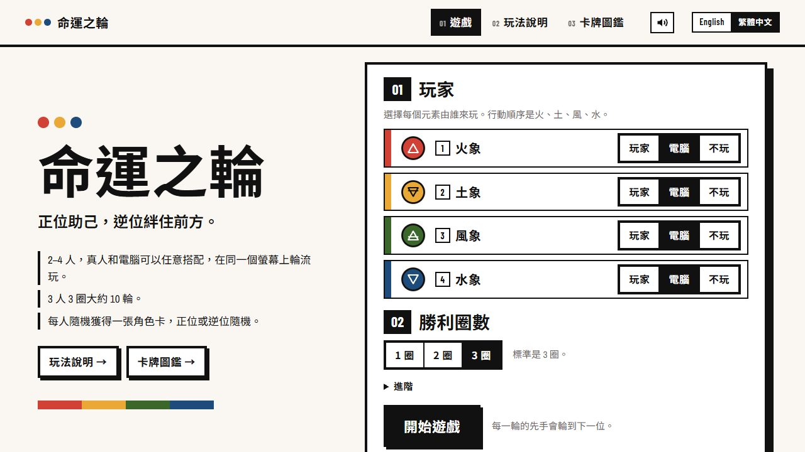
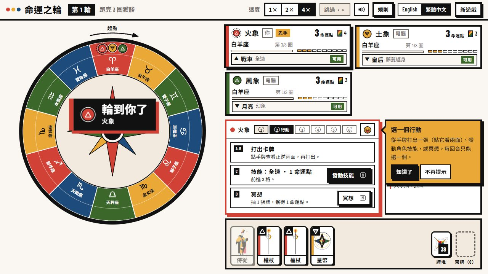
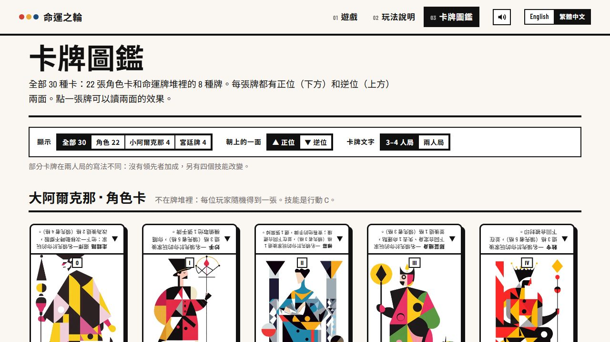

# Wheel of Fate 命运之轮 · 网页版

一款 2–4 人的塔罗主题赛跑桌游的网页版：棋子沿 12 星座组成的星盘赛跑，先跑完约定圈数、打完那一轮时跑得最远的人获胜。每张牌都有两面：

> **Upright to boost yourself. Reversed to trip the players ahead.**
> 正位助己，逆位絆住前方。

正位只给自己增益（前进、命运点、抽牌、护盾），逆位只能用来拦**领先于你**的玩家，所以落后的人也有办法反击。

**在线试玩：** https://arxentum.github.io/wheel-of-fate/



## 功能

- 2–4 人，每个座位可以设为真人或电脑；多名真人共用一台设备时，换人之间会遮住手牌（热座）。
- 电脑的回合逐步回放：棋子一格一格走、日志逐行出现，可以切换 1× / 2× / 4×，或跳到你下一次要做决定的时候。
- 界面、卡牌效果、日志全部提供 English / 繁體中文，游戏中途也能切换。
- 卡牌按印刷版用代码重画卡框：上方倒置的是逆位效果，下方是正位效果；点手牌可以预览两面再打出，不能用的选项会写明原因。
- 玩法说明页（`#/rules`）和卡牌图鉴页（`#/cards`）；游戏里按「规则」打开时游戏会暂停。
- 音效和背景音乐全部在浏览器里实时合成（Web Audio），没有音频文件：正位卡声音明亮、逆位低沉，最后一轮音乐加入心跳鼓点；顶部喇叭按钮可分别调节音乐和音效。
- 每一面卡都有自己的动画：宝剑逆位一剑劈退领先的人、星币逆位把金币吸回来、倒吊人逆位把目标倒吊、高塔正位闪电劈下……共 60 个，图鉴里可以预览。
- 表情：玩家可以发「太慢了！」「哈哈哈！」等表情嘲讽（按钮在行动面板标题行最右边），电脑也会看情况自动发（可以关掉）。
- 鼠标停在手牌上会在上方显示整张大牌；轮到你移动时星盘标出会停在哪里、加速后停在哪里、路上有没有别人的陷阱。
- 快捷键：S 技能、M 冥想、空格 确认、F 翻转、R 重掷、B 加速、1–9 选手牌、↑↓ 打出正位 / 逆位；按钮上标着对应按键。
- 结算画面有每轮位置折线图和本局统计（出牌、打退别人、被打退、获得命运点、陷阱触发）；日志按玩家上色，可以只看重点。
- 第一次玩时，遇到选行动、逆位、翻转、移动会各弹出一次提示（可关闭，规则页可重新打开）；回放速度会记住上次的选择。
- 规则引擎是纯 TypeScript，带种子随机数：同一个种子、同样的玩家，洗牌和骰子结果完全相同。

| 游戏画面 | 卡牌图鉴 |
|---|---|
|  |  |

## 快速开始

需要 Node.js 20.19 以上（或 22.12 以上）。

```powershell
npm install
npm run dev
```

然后打开 http://localhost:5173 。

## 常用命令

| 命令 | 作用 |
|---|---|
| `npm run dev` | 开发服务器（改代码即时刷新） |
| `npm run build` | 类型检查 + 构建静态网站到 `dist/` |
| `npm run preview` | 本地预览 `dist/` |
| `npm test` | Vitest：引擎、电脑、卡牌文字、字典、界面逻辑（约 265 个测试） |
| `npm run typecheck` | 只做类型检查 |
| `npm run e2e` | 构建后用 Playwright 跑 12 个冒烟测试（中英各一遍，另有平板触屏、手机、声音和键盘操作），截图写到 `docs/m5/screenshots/` |
| `npm run sim` | 平衡模拟器，生成 `docs/balance-report.md`；单独一组：`npm run sim -- --players 3 --laps 3 --games 10000` |
| `npm run cards` | 从 `D:\Tarot Game\卡牌成品\` 裁出卡图到 `public/cards/`（原图只读，不会被改） |
| `npm run terms` | 从字典生成中英界面用词对照表 `docs/m4/ui-terms.md` |
| `npm run check:cards` | 检查 60 面卡的文字在两种语言下都放得进卡框（需要先开 `npm run dev`） |
| `npm run check:audio` | 在浏览器里离线渲染每个音效和三档背景音乐，量峰值和响度，标出没声音、削波或明显过响过轻的（需要先开 `npm run dev`） |
| `npm run check:layout` | 在 8 种笔记本、平板、大屏尺寸下打开各个画面，截图并列出被裁掉的内容（需要先开 `npm run dev`，截图在 `test-results/layout/`） |

Playwright 默认使用电脑上已安装的 Chrome，不需要另外下载浏览器；在没有 Chrome 的电脑上可以设 `PW_CHANNEL=msedge`，或设为空字符串并运行 `npx playwright install chromium`。

## 项目结构

```
src/
  engine/        规则引擎（纯 TypeScript，不依赖浏览器）
    data/        星盘、卡牌参数、数值配置（balance.ts、cards.ts）
    core/        开局、合法性检查、执行动作、枚举合法动作
    effects/     各张卡的效果
    rules/       状态、陷阱、命运点
    bot/         电脑对手（隐藏信息下的一步估值）
  sim/           平衡模拟器（npm run sim）
  i18n/          字典 en.json、zh-Hant.json 和占位符填充
  ui/
    game/        GameController（回放、跳过、热座、暂停）、卡牌文字、日志文字、可选操作
    audio/       音效和背景音乐：事件对应的音效、编曲、Web Audio 合成和音量
    screens/     开始画面、游戏画面、玩法说明、卡牌图鉴
    components/  星盘、卡牌、棋子、按钮、弹窗等
tests/           Vitest
e2e/             Playwright 冒烟测试和截图、版面检查脚本
scripts/         卡图裁切、用词表生成
public/cards/    裁好的卡图（WebP 1x / 2x）
docs/            规划、决定记录、平衡报告、各阶段截图
```

## 规则和数值

- 规则依据是 `D:\Tarot Game\Wheel_of_Fate_Rules_v5.md`（规则书 v5）。规则书没写清楚的地方，逐条决定记在 [docs/decisions.md](docs/decisions.md)（D-01 – D-82）。
- **改数值**：只改 `src/engine/data/balance.ts`（费用、起始资源、陷阱等）和 `src/engine/data/cards.ts`（每张卡每一面的参数，以及两人局的写法）。卡牌上的文字、玩法说明页、置灰原因里的数字都从这里读取，会自动跟着变。改完运行 `npm test` 和 `npm run sim`，看 [docs/balance-report.md](docs/balance-report.md) 里各角色的胜率。
- **改文字**：界面文字和卡牌效果在 `src/i18n/en.json` 和 `src/i18n/zh-Hant.json`，两边的键和占位符必须一致（`npm test` 会检查）。英文单复数写成 `{n|space|spaces}`。

## 部署

`npm run build` 生成的 `dist/` 是纯静态网站：

- 资源路径是相对路径，放在网站根目录或任何子目录都能用；
- 页面切换用 `#/rules` 这类网址，不需要服务器做重写；
- 体积：JS 约 130 KB、CSS 约 60 KB（gzip 后）；卡图 1x、2x 各约 4 MB，浏览器按屏幕只取其中一套，而且卡片出现时才加载；中文字体按需分片加载。

可以直接上传到任何静态网站服务（GitHub Pages、Cloudflare Pages、Netlify 等）。本仓库用 GitHub Pages：推送到 `main` 后，`.github/workflows/deploy.yml` 会自动跑测试、构建并发布。

## 文档

| 文件 | 内容 |
|---|---|
| [docs/m0-plan.md](docs/m0-plan.md) | 最初的规划：技术选型、里程碑、风险 |
| [docs/decisions.md](docs/decisions.md) | 所有规则和界面决定 |
| [docs/balance-report.md](docs/balance-report.md) | 平衡模拟报告 |
| [docs/m4/ui-terms.md](docs/m4/ui-terms.md) | 中英界面用词对照 |
| [docs/m5/screenshots/](docs/m5/screenshots/) | 中英截图（由冒烟测试生成） |

## 素材和字体

- 卡面插画、星盘设计和游戏规则来自原版桌游作品（`D:\Tarot Game`）；网页版只读取这些原始文件，不修改。
- 字体：Anton、Archivo Narrow、Barlow Condensed、Noto Sans TC，均为 SIL Open Font License 1.1，通过 Fontsource 打包在网站里，不从外部加载。
