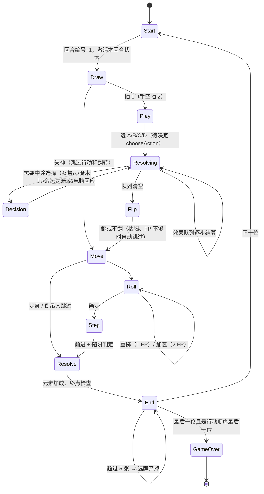

# M0 计划：Wheel of Fate 命运之轮 · 网页版

日期：2026-11-22
规则依据：`../Wheel_of_Fate_Rules_v3.md`（下文「§x」= 规则书章节）。规则歧义的逐条处理见 [decisions.md](decisions.md)（D-01 … D-50）。

---

## 0. 看过的资料

| 资料 | 要点 |
|---|---|
| 规则书 v3 | 唯一规则来源；v2 文件里只剩一句「本文件已作废」。 |
| `卡牌成品\` 30 张 + `背面.png` | 都是 827×1417。版式一致：顶部倒置的逆位效果区（y≈25–145，下方一条黑线）、插画（y≈150–1160）、卡名条方框（y≈1163–1272）、底部正位效果区（y≈1275–1395），四周圆角点状虚线边框，效果区左侧有黄色三角叠浅色六芒星的图标。`背面.png` 是一颗彩色罗盘星。`背面2.png` 是 3 倍高清卡背（不用，D-46）。`打印\` 文件夹里的分组（10张 / 两张 / 一张）和 §3.3 的数量一致。 |
| 旧作品集 PDF（6 页） | Game Rules、Sample Test（复杂度、随机性、FP 主导结局的问题）与 Solution（Controlled Card Draws、Fate Point Adjustments、Strategic Buffs）、Card Design、Final Work。 |
| 实物照片 6 张 | 黑底金线星盘、白底卡牌、金属棋子。 |
| Figma 最终版（已连上，只读） | **Game System Map**：12 格圆环，白羊座在正上方、顺时针；每格是元素色块 + 白色星座符号 + 英文名；中间米白圆盘上一颗八角罗盘星（红色竖、绿色横、蓝/黄斜），黑色圆心；「START HERE」标在白羊座旁。只有水瓶座涂成蓝色，其余 11 格和元素一致。**Turn Flow**：六个圆角卡片，黑色编号圆章 + 粗压缩标题 + 图标 + 一句说明，中间黑箭头。整体：米白底、黑色 01–11 编号方块、粗黑压缩标题字、红黄蓝黑几何装饰块。这些会作为 M3 的视觉参考。 |

`GC7 塔罗奥德赛策划案.docx`、`技能.docx` 按你的要求没有当规则来源（规则书已经吸收了需要的部分）。

---

## ① 规则理解摘要

**目标**：2–4 人在 12 星座的环形星盘上赛跑，先跑完约定圈数。有人到终点后**打完这一轮**再结算，进度最高者胜（超过终点的也算），平手比 FP，再平手共同获胜。

**核心创新**：每张牌两面——**正位只给自己增益**（前进、FP、抽牌、护盾、更好的掷骰），**逆位只给别人使绊**（后退、扣 FP、弃牌、负面状态、陷阱）。每回合的抉择是「冲自己，还是拦别人」。小阿卡纳和宫廷牌打出时自己选朝向；角色卡（大阿卡纳）的朝向要提前花 1 FP 翻好。

**星盘与进度**：12 格，白羊开始顺时针，元素按火→土→风→水循环，同元素每隔 4 格出现一次。每人只记一个不封顶的「进度」：星座 = 进度 mod 12，圈数 = ⌊进度 / 12⌋。后退最低到 0。

**资源**
- **FP 命运点**：开局 3，上限 10，扣到 0 为止。用途：重掷（1）、加速 +1 格（2）、翻转角色（1）、发动技能（1）。来源：星币、冥想、共鸣（在同元素格打同元素小牌 +1）、元素加成（移动后停在自己元素格 +1）、过圈（+2）、各种技能。**不直接决定胜负**。
- **手牌**：开局 3 张，每回合抽 1（手空抽 2），回合结束上限 5。
- **命运骰**：1–3。

**牌**
- 命运牌堆 48 张：4 种小阿卡纳各 10 张 + 4 种宫廷牌各 2 张。抽空时洗弃牌堆。
- 四种花色 = 四种资源：权杖=移动、星币=FP、宝剑=掷骰和位置、圣杯=手牌。正位给自己加，逆位削别人。
- 宫廷牌不能单出，要配 2 张指定元素的小牌（正逆位元素要求不同），打完抽 1，效果约 3–4 格。
- 22 张大阿卡纳是角色：开局随机分配、随机朝向，公开。发动技能 = 行动（1 FP，按当前朝向，不能连续两个回合发动）。世界的两面各「每局一次」。

**行动顺序**：按元素棋子：权杖（火）1、星币（土）2、宝剑（风）3、圣杯（水）4；不满 4 人跳过空位。

**回合六步**（对应作品集 Turn Flow）
1. **Draw 抽牌**：抽 1（手空抽 2）。
2. **Play 行动**，四选一：A 打一张小阿卡纳（选朝向，可能共鸣）；B 宫廷组合；C 角色技能；D 冥想（抽 1 + 1 FP）。
3. **Flip 翻转**（可选）：1 FP 翻转角色朝向，影响之后的回合。
4. **Move 移动**：掷骰 1–3；可花 1 FP 重掷一次、可花 2 FP 多走 1 格；停在陷阱上触发。
5. **Resolve 结算**：停在自己元素格 +1 FP；过白羊座 +2 FP；检查终点。
6. **End 结束**：弃到 5 张、清过期状态、换下一位。

**状态**（作用于目标的**下一个回合**，同种不叠加）：迟缓（最多走 1 格）、封印（不能出牌）、枯竭（不能花 FP）、失神（跳过行动和翻转）、定身（跳过移动步）；增益「护盾」挡下一次别人的逆位效果或陷阱。

**陷阱**（恶魔逆位、月亮逆位放置）：放在星座上，全场最多 3 个（第 4 个挤掉最早的），别人移动步结束停在上面才触发，触发后消失；枷锁 = 下回合定身 + 失 2 FP，幻象 = 后退 3 格；护盾可挡。

**赛车游戏式机制**：尾流（恋人正位）、落后追赶（正义正位）、专打第一（正义逆位、高塔逆位）、香蕉皮（陷阱）、护盾。

**平衡基准**（§10）：1 格 ≈ 2 FP，1 张牌 ≈ 0.5 格；小牌 ≈ 1 格，组合 ≈ 3–4 格，技能 ≈ 2.5–3.5 格，冥想 ≈ 1 格。目标：3 人局 8–12 轮；角色胜率偏离 1/人数不超过 ±7 个百分点；正逆位任何一边不超过 75%。

**电脑**（§12）：单一难度，枚举所有合法行动按估值打分（自己前进 1 格 = 2 分，对手后退 1 格 = 1.5 分（两人局 2 分）且优先打领先者，1 FP / 1 张牌 = 0.5 分，状态按 §10 换算，领先时偏正位和护盾、落后时偏逆位）；翻转、陷阱位置、重掷、加速各有简单规则。

---

## ② 歧义和冲突（摘要）

完整的 50 条见 [decisions.md](decisions.md)，下面是**会改变玩法**、最需要你确认的几条：

| # | 问题 | 我的处理 |
|---|---|---|
| D-14 | 「每次向前越过白羊座 +2 FP」——被推回再走过去要不要再给？ | 只在第一次到达新的一圈时给（记最高圈数）。 |
| D-30 | 世界正位「前进到双鱼座」+ 通用规则「不含当前格」：站在双鱼座会走 12 格。 | 站在双鱼座时不能用（置灰）。 |
| D-16 | 愚者逆位「下一次移动时后退 1 格」不是 §6 里的状态，且和「下一个回合」的状态模型不一样。 | 做成「走錯路」状态，持续到目标下一次真正进行移动步；护盾可挡。 |
| D-15 | 元素加成「移动步结束时停在…」和陷阱的先后。 | 只在真的移动过才判定；按陷阱生效后的位置判定。 |
| D-17 | 状态施加在目标**自己的回合里**时，「下一个回合」指哪个？ | 一律是目标的下一个自己回合。 |
| D-19/20 | 护盾挡「一次效果」的粒度；遇到交换位置、平分 FP 这类多人效果怎么办。 | 挡一张牌对你的全部影响；交换时任一方有护盾则整个交换失败；平分时有护盾的人不参与。 |
| D-37 | 有人过终点触发最后一轮，但之后又被打回终点以下。 | 标记不撤销，打完这一轮照常结算，只看进度。 |
| D-27 | 「前方 / 领先于你」按格子还是按进度？被套圈的人算不算前方？ | 一律按进度，套圈的人不算前方。 |
| D-29 | 国王逆位「所有其他玩家枯竭」是否包括被指定的目标。 | 包括（= 出牌者以外的所有人）。 |
| D-01 | 共鸣的范围。 | 只有真正打出小阿卡纳时（行动 A、魔术师额外打出）；宫廷组合不算；按出牌前所在格判定。 |
| D-26 | 「领先者」并列。 | 自己并列第一也算领先；效果指定领先者时由出牌者在并列者中选。 |

**和设计原则有出入、留到 M1 用数据判断的点**（不是规则冲突，先照规则书做）：
- §0 说「逆位只给别人使绊」，但审判逆位「平分 FP」会让穷的对手**获得** FP。电脑会在它削弱有钱的领先者时才用。
- 世界正位从白羊座出发能一次走 11 格（虽然每局一次），恋人正位最多 6 格——这两张最可能超过 ±7 个百分点。
- 倒吊人正位（不移动换 4 FP + 2 牌 + 护盾）按 §10 换算净值约 1.5 格，可能偏弱。

**素材上的出入**：
- 作品集星盘只有水瓶座颜色不对（Figma 里确认过），游戏按元素用绿色（§3.1）。
- 卡面上混用 Destiny Point / Fate Points，统一为 Fate Points（§1）。
- 宫廷牌卡面印的是复数 PAGES 等，游戏用单数（D-45）。

---

## ③ 设计

### 3.1 技术选型

| 部分 | 选型 |
|---|---|
| 构建 / 界面 | Vite + React + TypeScript（strict），纯静态网站 |
| 测试 | Vitest（引擎、模拟器、字典完整性）；Playwright（M5 冒烟测试 + 截图） |
| 模拟器 | `npm run sim` → 用 `tsx` 直接在 Node 里跑 `src/sim/cli.ts`，和网页共用 `src/engine/` |
| 图片 | `sharp`（Node）裁图、输出 WebP 1x / 2x |
| 字体 | `@fontsource` 本地打包 Anton / Archivo Narrow / Barlow Condensed / Noto Sans TC（D-50） |
| 本机环境 | Node 26.13、npm 11.20、git 2.56 已确认可用 |

引擎不依赖任何第三方库（不用 Immer、不用随机数库），保证模拟器跑得快、行为可复现。

### 3.2 文件夹结构

```
D:\Tarot Game\web\
├─ docs\                  m0-plan.md、decisions.md、balance-report.md（M1）
├─ scripts\
│  └─ build-cards.ts      M2：从 ..\卡牌成品\ 裁图 → public\cards\{1x,2x}\*.webp（原图只读）
├─ public\cards\          M2 生成的卡图
├─ src\
│  ├─ engine\             纯 TypeScript：不碰 DOM、window、localStorage，也不读文件
│  │  ├─ types.ts         所有类型（见 3.3）
│  │  ├─ data\
│  │  │  ├─ board.ts      12 星座、元素、颜色键、元素顺序
│  │  │  ├─ cards.ts      48 张命运牌 + 22 个角色的定义：每一面的目标类型和数值
│  │  │  └─ balance.ts    全局数值（开局 FP/手牌、上限、重掷/加速/翻转/技能费用、过圈奖励…）
│  │  ├─ core\
│  │  │  ├─ rng.ts        带种子的随机数（sfc32），状态存在 GameState 里
│  │  │  ├─ setup.ts      createGame(setup, seed)
│  │  │  ├─ flow.ts       回合状态机：自动推进没有决定的步骤，遇到决定就停
│  │  │  ├─ options.ts    当前决定的全部候选项 + 不可用原因（界面置灰、电脑枚举都用它）
│  │  │  └─ apply.ts      applyAction(state, action)：校验 → 执行 → 返回新状态和事件
│  │  ├─ rules\           move.ts、status.ts、shield.ts、trap.ts、deck.ts、fp.ts、victory.ts
│  │  ├─ effects\         minor.ts、court.ts、major.ts：每一面一个 resolve
│  │  ├─ ai\              evaluate.ts（§12 估值）、bot.ts（chooseAction）
│  │  ├─ events.ts        事件类型（日志、动画、统计都从这里来）
│  │  └─ index.ts         对外只导出 createGame / options / applyAction / chooseAiAction / 查询函数
│  ├─ sim\                cli.ts、runGame.ts、stats.ts、report.ts（写 docs\balance-report.md）
│  ├─ i18n\               en.json、zh-Hant.json、index.ts（t(key, params)、复数）
│  ├─ ui\
│  │  ├─ screens\         Setup、Game、HowToPlay、Gallery、Handoff
│  │  ├─ components\      Board、Piece、ElementIcon、Card、CardFace、Hand、PlayerPanel、TurnSteps、Log、DeckPile、Dice、TargetPicker…
│  │  ├─ hooks\           useGame（状态 + 电脑回合节奏 + 动画队列）、useLang
│  │  └─ styles\          tokens.css（颜色、字体、线宽）、全局样式
│  └─ main.tsx
├─ tests\                 Vitest：engine\cards\*.test.ts、engine\rules\*.test.ts、i18n.test.ts…
├─ e2e\                   Playwright（M5）
├─ index.html、package.json、tsconfig.json、vite.config.ts、vitest.config.ts、playwright.config.ts
└─ README.md              M5
```

### 3.3 数据结构

`GameState` 是**纯 JSON**（没有类实例、没有函数、没有 Map），所以可以直接存档、复制、做测试快照、用同一个种子复现。

```ts
// ---- 基础 ----
type Element = 'fire' | 'earth' | 'air' | 'water';
type Suit = 'wands' | 'pentacles' | 'swords' | 'cups';          // 火 土 风 水
type CourtRank = 'page' | 'knight' | 'queen' | 'king';
type MajorId = 'fool' | 'magician' | 'highPriestess' | /* …共 22 个… */ 'world';
type Orientation = 'upright' | 'reversed';
type PlayerId = 0 | 1 | 2 | 3;     // 开始画面里的座位号
type SignIndex = number;            // 0..11，0 = 白羊

// ---- 卡牌定义（静态数据，data/cards.ts）----
interface FaceDef {
  targeting: Targeting;             // 这一面需要玩家做什么选择
  params: Record<string, number>;   // 数值；字典里的效果文字用同一组参数插值，改数值文字自动跟着变
}
type Targeting =
  | 'none'
  | 'otherPlayer'                   // 任意一名其他玩家
  | 'twoOtherPlayers'               // 恋人逆位（两人局自动改为 otherPlayer）
  | 'leaderTie'                     // 领先者并列时才需要选（D-26）
  | 'sign'                          // 放陷阱
  | 'discardUpTo';                  // 审判正位 / 死神正位：选要弃的牌
interface MinorDef { kind: 'minor'; id: Suit; element: Element; copies: 10;
                     upright: FaceDef; reversed: FaceDef }
interface CourtDef { kind: 'court'; id: CourtRank; copies: 2;
                     requires: Record<Orientation, [Element, Element]>;
                     upright: FaceDef; reversed: FaceDef }
interface MajorDef { kind: 'major'; id: MajorId; number: number; // 0..21
                     oncePerGame?: true;                           // 世界
                     upright: FaceDef; reversed: FaceDef }

// ---- 牌的实例 ----
type CardUid = number;                                   // 0..47
interface CardInstance { uid: CardUid; def: Suit | CourtRank }

// ---- 状态 ----
type StatusKind = 'slowed' | 'silenced' | 'drained' | 'stunned' | 'rooted'
                | 'shielded' | 'wrongTurn';
interface Status {
  kind: StatusKind;
  from: number;          // 目标自己的第几个回合开始生效（D-17）
  until: number;         // 到第几个回合结束为止；wrongTurn 为 Infinity（用掉才消失，D-16）
  source: FaceRef;       // 哪张牌给的（日志和悬停说明用）
}

// ---- 陷阱 ----
interface Trap { sign: SignIndex; kind: 'chain' | 'illusion'; owner: PlayerId; seq: number }

// ---- 玩家 ----
interface PlayerState {
  id: PlayerId; controller: 'human' | 'ai'; element: Element;
  progress: number;
  lapsRewarded: number;          // 已经拿过 +2 FP 的最高圈数（D-14）
  fp: number;
  hand: CardUid[];
  major: MajorId; orientation: Orientation;
  statuses: Status[];
  turnNo: number;                // 已开始的自己回合数（状态和冷却的时钟）
  lastSkillTurn: number | null;  // D-02
  onceUsed: { upright: boolean; reversed: boolean };   // 世界
  trapImmuneUntil: number | null;                      // 月亮正位（D-24）
}

// ---- 本回合 ----
type Step = 'start' | 'draw' | 'play' | 'flip' | 'move' | 'resolve' | 'end';
interface TurnState {
  player: PlayerId; step: Step;
  action: 'minor' | 'court' | 'skill' | 'meditate' | 'skipped' | null;
  rollMode: 'normal' | 'advantage' | 'fixed3';   // 顺风 / 皇帝号令
  skipMove: boolean;                              // 倒吊人正位
  roll: { dice: number[]; value: number } | null;
  rerolled: boolean; boosted: boolean; flipped: boolean;
  moved: boolean;                                 // 本回合是否真的进行了移动步（D-15）
}

// ---- 等待某位玩家做的决定 ----
type Decision =
  | { kind: 'chooseAction'; player: PlayerId }                     // 四选一
  | { kind: 'foresight'; player: PlayerId; cards: CardUid[] }      // 女祭司正位：借用哪张、拿哪张
  | { kind: 'conjure'; player: PlayerId }                          // 魔术师正位：是否额外打 1 张
  | { kind: 'veil'; player: PlayerId; target: PlayerId }           // 女祭司逆位：弃对方哪 2 张
  | { kind: 'wheelTarget'; player: PlayerId; card: CardUid }       // 命运之轮逆位：翻牌者选目标
  | { kind: 'flip'; player: PlayerId }
  | { kind: 'move'; player: PlayerId }                             // 重掷 / 加速 / 确定
  | { kind: 'discardToLimit'; player: PlayerId; count: number }
  | { kind: 'gameOver' };

// ---- 玩家的输入 ----
type Action =
  | { type: 'playMinor'; card: CardUid; orientation: Orientation; target?: PlayerId }
  | { type: 'playCourt'; card: CardUid; fuel: [CardUid, CardUid]; orientation: Orientation;
      target?: PlayerId }
  | { type: 'useSkill'; choice?: SkillChoice }
  | { type: 'meditate' }
  | { type: 'foresightPick'; use: CardUid | null; take: CardUid }
  | { type: 'conjurePlay'; play: { card: CardUid; orientation: Orientation; target?: PlayerId } | null }
  | { type: 'veilPick'; cards: CardUid[] }
  | { type: 'chooseTarget'; target: PlayerId }
  | { type: 'flip'; flip: boolean }
  | { type: 'reroll' } | { type: 'boost' } | { type: 'confirmMove' }
  | { type: 'discard'; cards: CardUid[] };
interface SkillChoice { target?: PlayerId; targets?: [PlayerId, PlayerId];
                        sign?: SignIndex; discard?: CardUid[] }

// ---- 整局 ----
interface GameState {
  schema: 1;
  seed: string; rng: [number, number, number, number];   // sfc32 状态
  config: { laps: number; finish: number; balance: BalanceConfig };
  cards: CardInstance[];
  players: PlayerState[];
  order: PlayerId[];          // 行动顺序：按元素 火→土→风→水
  round: number;              // 第几轮（每人各行动一次 = 1 轮）
  turn: TurnState;
  deck: CardUid[]; discard: CardUid[];
  traps: Trap[]; trapSeq: number;
  finalRound: boolean;        // D-37
  pending: Decision | null;   // 正在等谁做什么决定
  queue: EffectStep[];        // 没结算完的效果步骤（纯数据，见 3.5）
  log: GameEvent[];
  result: { ranking: PlayerId[][]; winners: PlayerId[] } | null;
}
```

**事件**（日志、动画、统计共用）：只存「事件类型 + 参数」，不存句子；日志在显示时才用当前语言拼句子，所以中途切语言，**已有的**记录也会跟着变。

```ts
type GameEvent =
  | { t: 'turnStart'; p: PlayerId; round: number }
  | { t: 'draw'; p: PlayerId; n: number }
  | { t: 'play'; p: PlayerId; face: FaceRef; target?: PlayerId; resonance: boolean }
  | { t: 'move'; p: PlayerId; from: number; to: number; cause: Cause }
  | { t: 'fp'; p: PlayerId; delta: number; reason: FpReason; lostToCap: number }
  | { t: 'status'; p: PlayerId; kind: StatusKind; turns: number }
  | { t: 'shieldBlock'; p: PlayerId; source: FaceRef }
  | { t: 'trapPlace' | 'trapTrigger' | 'trapExpire'; trap: Trap; p?: PlayerId }
  | { t: 'lap'; p: PlayerId; lap: number }
  | { t: 'roll'; p: PlayerId; dice: number[]; value: number; reroll: boolean }
  | { t: 'finalRound'; p: PlayerId }
  | { t: 'gameOver'; winners: PlayerId[] }
  | /* … */;
```

### 3.4 回合状态机



推进方式：`applyAction` 处理完一次输入后，`flow` 会一直自动往下走，直到遇到下一个需要决定的点（`pending`）或游戏结束。界面和电脑都只做一件事：看 `pending` 是谁的、调用 `options()` 拿候选项、回一个 `Action`。

### 3.5 效果系统

- 每一面的效果由**几个小积木**组成：`moveSelf(n)`、`moveToNext(element)`、`pushBack(target, n)`、`pushBackToPrev(target, element)`、`gainFp(n)`、`loseFp(target, n)`、`steal(target, n)`、`draw(n)`、`discardRandom(target, n)`、`addStatus(target, kind, turns)`、`shieldSelf()`、`placeTrap(kind, sign)`、`swap(a, b)` …
- **护盾只在一个地方判定**：所有「影响别人」的积木都经过 `affect(effectId, target)`，同一次效果对同一个人只判定一次护盾（D-19）。
- **移动只走一个函数**：所有位移都经过 `moveTo(player, newProgress, cause)`，统一处理下限 0、过圈奖励（D-14）、终点触发（D-37），并写事件。陷阱**只在**移动步里判定。
- 大多数选择在出牌时一起给出（目标、陷阱格、要弃的牌）；只有「先看到信息才能选」的（女祭司、魔术师、命运之轮逆位、移动步的重掷）才拆成中途决定，效果的剩余步骤以纯数据存在 `queue` 里，所以中途暂停的状态也能存档和测试。
- 数值全部在 `data/cards.ts` / `data/balance.ts`，M1 调平衡只改数据，不动逻辑；README 会写怎么改。

### 3.6 多语言

- `src/i18n/en.json`、`zh-Hant.json`：界面、卡名、技能名、效果文字、状态、置灰原因、事件记录全部是键值，组件里不写死任何文字。
- 效果文字以规则书原文为准，数字用参数插值（`{n}`），英文单复数由 `t()` 处理（space / spaces）。
- 一个 Vitest 测试保证两份字典的键完全一致、所有 `{参数}` 对得上、没有空值；另一个测试检查每张牌每一面、每个状态、每种事件都有对应的键。

### 3.7 电脑对手（M1）

- 按 §12：用 `options()` 枚举所有合法行动（每张小牌 × 两面 × 每个目标、能组成的宫廷组合、技能的每种选择、冥想），每个行动按估值打分取最高；同分时用随机数打破（仍可复现）。
- 估值：在一份**状态副本**上执行这个行动，比较执行前后的差值（自己进度、对手进度、FP、手牌、状态），按 §12 的权重换算成分数；对手后退按「是否领先者」加权；自己领先时正位/护盾加权，落后时逆位加权。这样新卡牌不需要单独写估值。
- 中途决定（女祭司选哪张、弃哪张、陷阱放哪、重掷/加速/翻转）按 §12 的简单规则。
- 电脑只用公开信息 + 自己的手牌（女祭司逆位看到的对手手牌除外），不偷看。

### 3.8 模拟器（M1）

```
npm run sim                        # 跑全部：2/3/4 人 × 1/2/3 圈 × 2000 局 + 默认配置 20000 局，写报告
npm run sim -- --players 3 --laps 2 --games 500 --seed 42   # 单独跑一组
```

- 每局的种子 = 总种子 + 局号，任何一局都能单独复现、在网页里回放。
- 统计通过监听事件完成（不在引擎里加统计代码）：角色胜率、座位（行动顺序）胜率、元素胜率、平均轮数及分布、正逆位比例（分三类）、FP 撞上限、每种牌打出率、陷阱触发率、终局时进度差。口径见 D-39 … D-42。
- 报告用中文写进 `docs/balance-report.md`：结论在前，表格在后；偏离目标的条目给出修改建议和改后重跑的对比。

### 3.9 测试计划（M1 起）

- **每一面一个以上的测试**：22 个角色 × 2 + 4 种小牌 × 2 + 4 种宫廷 × 2 = 60 面。用一个 `scenario()` 构造器精确摆好局面（位置、手牌、FP、状态、陷阱、牌堆顶），执行一个行动，断言结果和事件。
- **规则测试**：抽牌（手空抽 2、洗牌）、共鸣、元素加成、过圈（含被推回再过）、FP 上下限、6 种状态 + 走错路的时机和合并、护盾（单体、全体、交换、平分、陷阱、刷新、过期）、陷阱（放置、上限 3、放置者免疫、路过不触发、效果推到不触发、月亮免疫）、冷却、世界每局一次、终局（最后一轮、被推回、平手比 FP、共同获胜）。
- **整体测试**：同一种子跑两次结果完全相同；1000 局电脑对局不报错、没有死循环、每局都能结束；每一步都只有合法的 `pending`。
- **字典测试**：见 3.6。

---

## 4. 后续里程碑的要点

| 里程碑 | 要点 |
|---|---|
| M1 引擎 + 电脑 + 模拟器 | 按 3.3–3.9 实现；先单元测试，后模拟器；报告给建议值和重跑结果，你同意后才改规则书。 |
| M2 素材 | `scripts/build-cards.ts` 逐张裁插画（D-43），1x（约 400 宽）和 2x（原始宽度约 780）WebP；先出一张对比图给你看裁切边界。星盘做成 React 内的 SVG（12 段元素色 + 星座符号用 SVG 路径画，不依赖字体里的符号）；四元素图标用传统炼金术三角（火 △、水 ▽、风 △ 加横线、土 ▽ 加横线），棋子 = 元素色 + 元素符号，色弱也能分清。 |
| M3 可玩版本 | 开始画面、游戏画面（星盘、四个玩家面板、手牌、牌堆、六步指示、事件记录）、正逆位双面预览、置灰原因、遮挡交接画面、电脑回合动画和加速/跳过。 |
| M4 双语与说明 | 中途切语言；玩法说明页；卡牌图鉴页。 |
| M5 打磨与发布 | 1280×720 以上的笔记本和平板横屏；Playwright 全电脑对局冒烟测试 + 中英截图；`npm run build`；部署方式建议（部署前问你）；中文 README。 |

## 5. 风险

1. **卡框里的文字长度**：英文和繁中效果都要塞进重画的卡框。手牌里的小卡只显示名字 + 图标，悬停或选中时显示大卡；卡框文字按长度自动缩字号，M4 用截图检查两种语言有没有溢出。
2. **平衡**：世界正位、恋人正位、审判逆位最可能失衡（见 ②）；默认圈数估计在 2 圈左右（每人每回合净前进约 3 格），以模拟为准。
3. **中文字体体积**：Noto Sans TC 很大，按 unicode-range 分片加载。
4. **少人局的座位和元素绑在一起**：2、3 人局的「座位胜率」也受元素位置影响（大家从白羊座出发，离各元素格的距离不同），报告里会分开看。
5. **热座模式的隐私**：只有命运之轮逆位会在别人的回合里要求另一位真人做选择，需要单独处理遮挡（D-32）。
